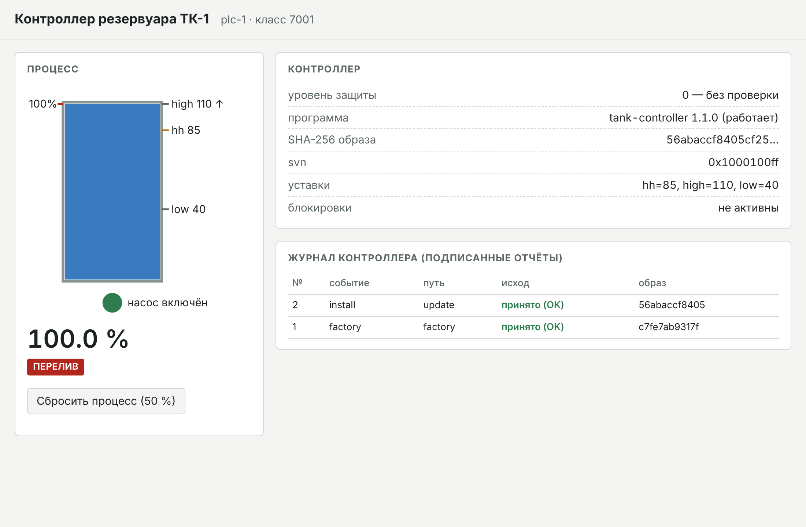

# cps-update-lab

[](https://github.com/alexqzm/cps-update-lab/actions/workflows/ci.yml)

Учебный стенд по целостности обновления ПО киберфизических систем (КФС). Вымышленный поставщик
выпускает ПО контроллера резервуара, гейт SCII решает, допустить ли выпуск, по графу
доказательств целостности цепочки сборки, а эмулятор ПЛК с физическим процессом устанавливает
обновление на одном из трёх уровней защиты. Нарушитель действует по схемам реальных атак из
[атласа cps-supply-chain-atlas](https://github.com/alexqzm/cps-supply-chain-atlas): подменяет
образ на сервере обновлений, подписывает свой образ похищенными ключами, заражает сборочную
среду, откатывает версию, загружает логику с подложной инженерной станции. Результат каждой атаки
виден в процессе: резервуар переливается или пустеет либо продолжает работать штатно.

Стенд сделан для исследования метода SCII к диссертации «Метод обеспечения целостности цепочки
сборки и обновления программного обеспечения киберфизических систем на основе графа
доказательств» и для обучения: к нему прилагаются семь лабораторных работ на русском языке.



## Результаты

11 сценариев × 3 уровня защиты контроллера = 33 исхода. Каждый прогон CI сверяет их с ожидаемыми
и проверяет, что таблица ниже и [`docs/results.md`](docs/results.md) (решения гейта, индексы,
сопоставления) совпадают с прогоном.

Уровни защиты: **L0** — без проверки (принимается любой образ правильного формата); **L1** —
загрузчик проверяет подпись образа ключом поставщика; **L2** — контроллер принимает и
обновление, и загрузку логики только с квитанцией гейта SCII, которую проверяет
[scii-agent](https://github.com/alexqzm/scii-verify).

<!-- results:begin -->
| Сценарий | L0: без проверки | L1: подпись поставщика | L2: квитанция гейта SCII | Гейт |
|---|---|---|---|---|
| N1 Штатное обновление 1.0.0 → 1.1.0 | принято; норма | принято; норма | принято; норма | допуск |
| A1 Подмена образа на сервере обновлений | принято; перелив, тревога монитора | отказ: BOOT_SIG; норма | отказ: DIGEST; норма | допуск |
| A2 Вредоносный образ, подписанный похищенными ключами поставщика | принято; перелив, тревога монитора | принято; перелив, тревога монитора | отказ: NO_RECEIPT; норма | отказ |
| A3 Компрометация сборочной среды | принято; перелив, тревога монитора | принято; перелив, тревога монитора | отказ: NO_RECEIPT; норма | отказ |
| A3b Компрометация сборочной среды без контрольной пересборки | принято; перелив, тревога монитора | принято; перелив, тревога монитора | отказ: NO_RECEIPT; норма | отказ |
| A4 Откат на подлинную версию с уязвимостью | принято; перелив | принято; перелив | отказ: ROLLBACK; норма | допуск |
| A5 Подлинный выпуск для другого класса устройства | принято; опустошение, тревога монитора | принято; опустошение, тревога монитора | отказ: TARGET; норма | допуск |
| A6 Загрузка логики с подложной инженерной станции | принято; перелив, тревога монитора | принято; перелив, тревога монитора | отказ: NO_RECEIPT; норма | — |
| A7 Выпускной архив не совпадает с тегом | принято; перелив, тревога монитора | принято; перелив, тревога монитора | отказ: NO_RECEIPT; норма | отказ |
| M1 Граница метода: скрытая функция производителя | принято; перелив | принято; перелив | принято; перелив | допуск |
| M2 Граница метода: команда по каналу управления | принято; опустошение | принято; опустошение | принято; опустошение | — |
<!-- results:end -->

Столбец «Гейт» — решение гейта по выпуску, который участвует в сценарии. В A1, A4 и A5 в канале
обновления лежат подпись и квитанция допущенного подлинного выпуска; «—» — гейт не участвует.

Что видно из таблицы:

- **Подпись поставщика не отличает подлинное от вредоносного.** Похищенные ключи (A2),
  заражённая сборочная среда (A3) и выпускной архив, не совпадающий с тегом (A7), дают образы с
  действительной подписью: L1 их принимает. Гейт их отвергает по свидетельствам цепочки —
  аттестациям сборки, подписанному тегу, независимой пересборке.
- **Квитанция привязывает допуск к устройству и версии.** Подлинный, но старый выпуск (A4) и
  подлинный выпуск для другого класса устройств (A5) проходят проверку подписи; квитанция их
  отсекает (`ROLLBACK`, `TARGET`).
- **Загрузка логики — отдельный путь.** Подложная инженерная станция (A6) обходит загрузчик и
  его подпись; на L2 контроллер требует квитанцию и на этом пути.
- **Границы метода.** Скрытая функция, которую выпустил сам поставщик (M1), проходит все
  проверки: SCII подтверждает происхождение, а не намерения. Команда по каналу управления с
  паролем по умолчанию (M2) обновления не требует вовсе.

## Быстрый старт

Нужен Docker с Compose v2. Первая сборка образа может занять несколько минут: загрузка базовых
образов и компиляция scii-agent.

```bash
git clone https://github.com/alexqzm/cps-update-lab && cd cps-update-lab
./lab.sh up                 # при первом запуске собрать образ; подготовить стенд и запустить службы
```

HMI оператора — http://127.0.0.1:8081, API контроллера — http://127.0.0.1:8080/api/status,
Modbus/TCP — 127.0.0.1:5020. Все порты открыты только на локальном адресе.

```bash
./lab.sh scenario A1 0      # подмена образа, контроллер без проверки: перелив
./lab.sh scenario A1 2      # то же на уровне L2: отказ DIGEST, процесс в норме
./lab.sh monitor            # проверка отчётов контроллера и журнала допусков гейта
./lab.sh matrix             # все 33 исхода в модельном времени
./lab.sh cli gate report tank-1.1.0-stolen-key   # отчёт гейта по выпуску
./lab.sh shell              # оболочка с /lab, cosign, gpg, git, scii-agent, source-match
./lab.sh down               # остановить (./lab.sh reset — ещё и удалить данные стенда)
```

После обновления репозитория пересоберите образ: `./lab.sh build`.

### Без Docker

Нужны Python 3.11+, git, GnuPG 2.2+, [cosign](https://github.com/sigstore/cosign) v2.4.1 и
scii-agent:

```bash
cargo install --locked --git https://github.com/alexqzm/scii-verify \
  --rev 1c4ac0ffbc5278c493db8a3ed8eae5cf8eef85e3 scii-agent
pip install -e ".[test]"
cpslab doctor               # проверить инструменты; пути можно задать в CPSLAB_COSIGN, CPSLAB_SCII_AGENT
cpslab init                 # ключи, репозиторий поставщика, выпуски, решения гейта (около 30 с)
cpslab scenario run A3      # один сценарий на трёх уровнях
cpslab scenario matrix
pytest                      # модульные, интеграционные и живые тесты
```

Рабочий каталог стенда — `./work` или `$CPSLAB_HOME`.

## Лабораторные работы

| ЛР | Тема | Сценарии |
|---|---|---|
| [ЛР-1](docs/labs/lab-1.md) | Штатное обновление: свидетельства, решение гейта, квитанция | N1 |
| [ЛР-2](docs/labs/lab-2.md) | Подмена образа на сервере обновлений | A1 |
| [ЛР-3](docs/labs/lab-3.md) | Компрометация поставщика: похищенные ключи и сборочная среда | A2, A3, A3b |
| [ЛР-4](docs/labs/lab-4.md) | Откат версии и выпуск для чужого устройства | A4, A5 |
| [ЛР-5](docs/labs/lab-5.md) | Загрузка логики с подложной инженерной станции | A6 |
| [ЛР-6](docs/labs/lab-6.md) | Выпускной архив не совпадает с тегом | A7 |
| [ЛР-7](docs/labs/lab-7.md) | Границы метода: что SCII не останавливает | M1, M2 |

Методические указания для преподавателя — [`docs/teacher.md`](docs/teacher.md).

## Как устроено

Подробно — в [`docs/architecture.md`](docs/architecture.md): поставщик и детерминированная
сборка, 17 свидетельств и ключи ролей, решение гейта, пути установки на контроллере, карта
Modbus, монитор и отличия стенда от метода.

| Модуль | Роль |
|---|---|
| `cpslab/vendor.py` | репозиторий поставщика, сборка, аттестации in-toto (cosign), подписи |
| `cpslab/gate.py` | гейт: scii-gate с профилем стенда, VSA, квитанция SCII-R v1, журнал допусков |
| `cpslab/device.py` | контроллер: уровни L0–L2, scii-agent, процесс, Modbus/TCP, подписанные отчёты, HTTP API |
| `cpslab/attacks.py`, `cpslab/scenarios.py` | действия нарушителя и 11 сценариев |
| `cpslab/server.py`, `cpslab/hmi.py`, `cpslab/monitor.py`, `cpslab/ews.py` | сервер обновлений, HMI, монитор, инженерная станция |
| `cpslab/data/scenarios.yaml` | каталог сценариев: ожидаемые исходы, записи атласа, ATT&CK, меры ОПО |

Сопоставления сценариев с техниками MITRE ATT&CK v20 и мерами раздела «Управление обновлениями
программного обеспечения» (ОПО) приказа ФСТЭК России № 239 — оценка автора; идентификаторы техник
сверены по словарю атласа.

## Ограничения

- Стенд учебный: ключи создаются при подготовке и хранятся открыто, протоколы и форматы
  упрощены. Не подключайте его к сетям с реальным оборудованием.
- Контроллер — эмулятор с декларативной программой, а не среда исполнения ПЛК; процесс — одна
  модель резервуара.
- Свидетельство аппаратной аттестации s54 не моделируется; s51–s53 проверяет стенд, а не
  scii-gate.
- Порог θ = 0,9 подобран под эталонный выпуск стенда и не является рекомендацией.

## Связанные репозитории

- [scii-gate](https://github.com/alexqzm/scii-gate) — гейт допуска обновлений по графу доказательств;
- [scii-verify](https://github.com/alexqzm/scii-verify) — формат квитанции SCII-R v1 и агент проверки на устройстве;
- [cps-supply-chain-atlas](https://github.com/alexqzm/cps-supply-chain-atlas) — атлас атак, из которого взяты сценарии;
- [source-match](https://github.com/alexqzm/source-match) — сверка выпускных архивов с тегами (к сценарию A7).

## In English

A hands-on lab for software update integrity in cyber-physical systems. A fictional vendor
releases PLC software, an SCII gate admits or rejects each release based on an evidence graph of
the build chain, and a PLC emulator driving a water tank installs updates at three protection
levels: no checks, vendor signature, and an SCII admission receipt verified on the device.
Eleven scenarios modelled on real incidents from cps-supply-chain-atlas (update server
compromise, stolen signing keys, build system compromise, rollback, rogue engineering
workstation, release tarball mismatch) show where each control stops the attack and where the
method's boundaries are. Lab exercises are in Russian.

## Лицензия и цитирование

Код и документация — Apache License 2.0 ([`LICENSE`](LICENSE)). Как ссылаться на стенд — в
[`CITATION.cff`](CITATION.cff).
