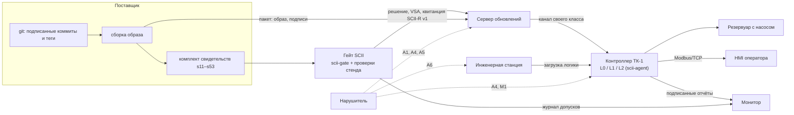

# Устройство стенда

Стенд моделирует цепочку выпуска и обновления ПО контроллера целиком: от коммита поставщика до
программы, которая управляет насосом резервуара. Все роли работают на одной машине; ключи
генерируются при подготовке (`cpslab init`) и существуют только в рабочем каталоге стенда.

## Поставщик

Вымышленный поставщик ведёт git-репозиторий с двумя изделиями: контроллер резервуара ТК-1
(`tank-controller`, класс устройства 7001; выпуски 1.0.0, 1.1.0, 1.2.0) и контроллер насосной
станции НС-2 (`pump-station`, класс 7002; выпуск 1.1.0). Коммиты и теги выпусков подписаны ключом
OpenPGP поставщика, даты коммитов фиксированы. Исходные файлы — в `cpslab/data/vendor-src/`.

Программа контроллера — декларативный JSON (`cpslab-program/1`): уставки с регистрами Modbus и
ограничениями min/max, правила и блокировки ПАЗ вида «если уровень ≥ hh, насос выключить». Кода в
программе нет, поэтому вредоносные изменения в сценариях выражаются теми же средствами, что и
подлинные: снять блокировку, поднять уставку, добавить правило.

Образ — архив tar (USTAR) из `manifest.json` и `program.json` с фиксированными метаданными: время —
время коммита, владелец 0, права 0644, JSON с упорядоченными ключами. Одна ревизия даёт побитово
одинаковый образ на любой машине — это условие свидетельств s23 и s24. Роль «тулчейна» играет файл
`cpslab/image.py`: его SHA-256 закреплён в политике получателя и записан в аттестацию
происхождения.

## Свидетельства и ключи ролей

| Свидетельство | Файл комплекта | Подпись | Что проверяет гейт |
|---|---|---|---|
| s11 подписи коммитов | `source/commit_object` | OpenPGP поставщика | подпись коммита ключом из политики |
| s12 рецензирование | `source/review.intoto.json` | cosign, роль reviewer | результат APPROVED, коммит выпуска |
| s13 статический анализ | `source/sast.intoto.json` | cosign, роль sast | анализ выполнен (COMPLETED) |
| s14 подписанный тег | `source/tag_object` | OpenPGP поставщика | тег выпуска указывает на ожидаемый коммит |
| s21 шаг сборки | `build/link.intoto.json` | cosign, роль builder | исходный коммит в материалах |
| s22 происхождение (SLSA) | `build/provenance.intoto.json` | cosign, роль builder | сборщик, коммит, SHA-256 тулчейна |
| s23 воспроизводимая сборка | `build/repro.intoto.json` | cosign, роль builder | пересборка из коммита дала тот же образ |
| s24 независимая пересборка | `build/rebuild-independent.intoto.json` | cosign, роль independent_builder | то же у второго сборщика |
| s31, s32 хранилище | `repository/log.jsonl` | cosign, роль repository | запись журнала с дайджестом и загрузившей ролью |
| s41 SBOM | `build/sbom.intoto.json` | cosign, роль builder | закреплённые зависимости совпадают |
| s42 подпись пакета | `package/*.sigstore.json` | cosign, роль vendor | подпись образа ключом поставщика |
| s43 испытания | `source/tests.intoto.json` | cosign, роль tester | результат PASSED |
| s51 подпись загрузчика | `package/*.bootsig` | Ed25519, vendor_boot | подпись образа ключом загрузчика (проверка стенда) |
| s52 антиоткат | — | — | версия образа выше установленной на парке (проверка стенда) |
| s53 привязка к устройству | — | — | класс устройства образа совпадает с парком (проверка стенда) |
| s54 аппаратная аттестация | — | — | на стенде не моделируется, всегда N |

Аттестации — in-toto Statement в DSSE, подписанные `cosign attest-blob` без загрузки в журнал
прозрачности (`--tlog-upload=false`). Нарушитель в сценарии A2 владеет только ключами vendor
(cosign) и vendor_boot; остальные аттестации он подписывает своим ключом.

## Гейт

Гейт — библиотека [scii-gate](https://github.com/alexqzm/scii-gate) с профилем стенда
`cpslab/data/profile.json` (копия профиля ArduPilot с проверками стадии устройства, заменёнными на
проверки стенда). Гейт получает ожидания выпуска (коммит и тег) из тега поставщика, подпись тега
проверяет ключом из политики, затем вычисляет состояния свидетельств (P — подтверждено, F —
опровергнуто, N — не предъявлено), индексы R_P^min…R_P^max и решение по правилам scii-gate, по
порядку:

1. не предъявлено обязательное свидетельство (s22 или s42) — запрос свидетельств;
2. опровергнуто любое свидетельство обязательной стадии (сборка, пакет обновления) — отказ (вето);
   верхняя граница R_P^max ниже θ — отказ;
3. опровергнутых свидетельств нет и нижняя граница R_P^min не ниже θ — допуск;
4. иначе — ручное рассмотрение.

Порог θ = 0,9 равен R_P^min эталонного выпуска N1 на стенде (всё подтверждено, кроме s54): любое
неподтверждённое свидетельство опускает индекс ниже порога. Это настройка стенда, а не
рекомендация для практики.

По каждому решению гейт пишет в `gate/runs/NNNN-<выпуск>/` отчёт (`report.md`, `report.json`),
сводку проверки SLSA VSA в DSSE, подписанную ключом гейта (`vsa.dsse.json`), и при допуске —
квитанцию SCII-R v1 (`receipt.scr`, 244 байта): класс и экземпляр устройства, svn, длина и SHA-256
образа, эпоха и дайджест политики, индексы, серийный номер и дайджест VSA. Решения сводятся в
журнал допусков `gate/ledger.jsonl`.

## Контроллер

Эмулятор ПЛК хранит конфигурацию, состояние (установленный образ, svn, минимальная эпоха
политики), ключ устройства и флеш-память в своём каталоге. Изменения попадают в контроллер тремя
путями:

| Путь | Что делает | L0 | L1 | L2 |
|---|---|---|---|---|
| обновление (`update`) | забирает пакет своего класса с сервера обновлений | только разбор образа | + подпись загрузчика (Ed25519) | квитанция (scii-agent), затем подпись загрузчика |
| инженерная станция (`ews`) | загрузка логики по сети, мимо загрузчика | только разбор | только разбор | квитанция (scii-agent) |
| управление (`mgmt`) | команды factory-reset, stop, start с паролем | пароль | пароль | пароль |

Квитанцию проверяет `scii-agent` из [scii-verify](https://github.com/alexqzm/scii-verify):
формат, ключ гейта, подпись, решение, класс и экземпляр устройства, дайджест и эпоха политики,
антиоткат, длина и дайджест образа. Код отказа агента (`DIGEST`, `ROLLBACK`, `TARGET`…) контроллер
пишет в отчёт.

Каждая попытка установки и каждая команда управления записывается в `reports.jsonl` отчётом,
подписанным ключом устройства (Ed25519). Отчёт — заготовка свидетельства s54 и вход монитора.

Процесс: резервуар, подача насоса 2 %/с, расход потребителя 1 %/с. Уровень 100 % — перелив, 5 % и
ниже — резервуар опустошён (сухой ход насоса), 95 % — аварийно высокий уровень. Сценарии в
модельном времени прогоняют процесс 300 с; живой контроллер ведёт его в реальном времени с
ускорением (`--speed`, по умолчанию 5).

Карта Modbus/TCP (порт 5020 на стенде; у реальных ПЛК — 502):

| Таблица | Адрес | Значение |
|---|---|---|
| регистры хранения | 0…199 | регистры программы: уставки (у ТК-1 low — 0, high — 1, hh — 2) и прочие |
| входные регистры | 0 | уровень × 10 |
| | 1 | уровень защиты |
| | 2…4 | версия программы: major, minor, patch |
| катушки | 0 | насос |
| дискретные входы | 0…4 | перелив, аварийно высокий уровень, опустошение, блокировка активна, программа загружена |

## Монитор

Монитор проверяет подпись каждого отчёта ключом устройства и сверяет образ из последнего
подлинного отчёта с журналом допусков: пара (класс устройства, SHA-256 образа) должна быть
допущена гейтом. Отказы устройства выводятся предупреждениями. Монитор не замечает отката на
старый, но когда-то допущенный образ (сценарий A4) и не видит действий, которые не меняют образ
(M1, M2).

## Канал рецептов ИИ-агента

Кроме образа программы, поведение контроллера меняют рецепты партии: шаги поверх программы (уставки,
ручной режим насоса, ожидания, выдержки, проверки качества). Рецепт составляет ИИ-агент через мост
MCP и сервер агента с уровнями доступа ключей, допускает гейт рецептов по графу из десяти
свидетельств (q11–q52) с тем же scii-gate, а контроллер на L2 исполняет рецепт только с квитанцией
SCII-R v1, привязанной к дайджесту рецепта, экземпляру устройства, политике допуска рецептов
(`gate/recipe-policy.json`) и ревизии. Подробно — в [`agent-recipes.md`](agent-recipes.md).

| Путь | L0 | L1 | L2 |
|---|---|---|---|
| рецепт (`recipe`) от сервера агента | только разбор | статическая проверка на сервере агента | квитанция гейта рецептов (scii-agent) |
| ручная команда (`command`, уровень Manual) | исполняется | исполняется | исполняется |

## Отличия от метода и инструментов

- **policy_digest.** В стенде это SHA-256 файла `gate/policy.json` (якоря доверия, ожидания к
  сборке, эпоха). Ожидания конкретного выпуска (коммит и тег) гейт берёт из подписанного тега при
  каждом допуске и в манифест политики не включает, поэтому `policy_digest` не меняется от выпуска к
  выпуску и контроллер вводится в эксплуатацию один раз. В описании формата scii-verify
  (`docs/receipt-format.md`) смена ожидаемых значений выпуска меняет `policy_digest`.
- **Антиоткат.** Проверка s52 гейта требует версию строго выше установленной на парке; scii-agent
  допускает повторную установку той же версии (`svn ≥ installed_svn`).
- **Стадия устройства.** s51–s53 проверяет стенд, а не scii-gate; s54 не моделируется.
- **Квитанции отказа.** Гейт стенда квитанций отказа не выпускает: отказ виден по отсутствию
  квитанции (`NO_RECEIPT`) и в отчёте гейта.
- **Процесс.** Модель одна — резервуар. Испытания поставщика (s43) для НС-2 идут на модели
  напорной линии из `products/pump-station/tests.json`; живого контроллера НС-2 на стенде нет.

## Безопасность стенда

Стенд учебный: все ключи создаются при подготовке и хранятся открыто в рабочем каталоге, пароль
управления по умолчанию `admin` — часть сценария M2. Службы `docker compose` (в том числе сервер агента,
порт 8026) публикуют порты только на 127.0.0.1 и работают от непривилегированного пользователя с файловой системой только для
чтения. Не подключайте стенд к сетям с реальным оборудованием и не используйте его ключи и форматы
вне стенда.
